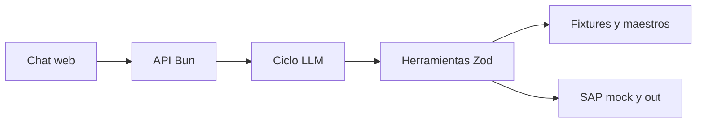

# Solución — Agente de Órdenes de Compra SAP

## 1. Problema

La analista administrativa pierde tiempo digitando y controlando manualmente cada OC; el agente centraliza el paquete, aplica controles y prepara la creación sin alterar evidencia ni montos.

## 2. Arquitectura

El comportamiento está en `agent/prompt.md`, el conocimiento en `src/knowledge/ordenes-compra.md` y la ejecución en `src/tools/oc.ts`. El frontend muestra conversación, estado de espera y cada llamada a herramienta.

## 3. Ciclo del agente

`AnthropicAdapter` mantiene el historial, envía herramientas tipadas y devuelve `tool_result` al modelo hasta el máximo configurable de 12 iteraciones. La creación valida de nuevo y exige `confirmado: true` ante excepciones. Sin clave se ofrece una ruta local para demostrar los fixtures sin modelo. Todas las llamadas se registran en `out/log.jsonl`.

## 4. Modelo

Se eligió Anthropic con `claude-opus-5`, configurable con `ANTHROPIC_MODEL`. El coste depende del volumen de prompt, llamadas y respuesta; el límite de iteraciones restringe el consumo. Se puede elegir un modelo inferior mediante variable de entorno para ambientes de demostración.

## 5. Matriz de controles

| Regla | Implementación |
|---|---|
| RC1 | proveedor por NIT o nombre normalizado y estado activo |
| RC2 | aprobación existente, texto Aprobado y aprobador del centro |
| RC3 | monto frente al tope del aprobador |
| RC4 | centro y subárea del maestro |
| RC5 | diferencia total solicitud/cotización ≤ 2 % |
| RC6 | IVA derivado y confirmado si falta |
| RC7 | condición de pago derivada e informada |
| RC8 | factura previa marca OC retroactiva y pide confirmación |
| RC9 | fecha de aprobación no previa a solicitud |
| RC10 | cantidad × valor unitario con tolerancia de una unidad |

RC5 es el control más sensible: no corrige el monto ni escoge entre documentos; detiene el flujo y deja la decisión a la persona.

## 6. Adaptador SAP real

Usaría SAP Integration Suite delante de `BAPI_PO_CREATE1` por permitir desacoplar red, credenciales, mapeos y monitoreo mientras se confirma viabilidad. El payload mapea proveedor, organización/sociedad, cabecera, posiciones, imputación a centro y condiciones a las estructuras BAPI; la evidencia se conserva como adjunto mediante el servicio documental de SAP. Las credenciales viven en un vault y se inyectan en el middleware, nunca en el prompt o frontend. La idempotencia usa `solicitud_id` como referencia externa antes de reintentar; ante error parcial se consulta el estado de la referencia antes de repetir. Como plan B, el agente genera el payload validado y una plantilla de carga revisable.

## 7. Lectura del proceso

Las OC retroactivas no deben ocultarse: se registran para medir frecuencia, proveedor, área y monto. Se recomienda bloquear preventivamente el registro de factura cuando no exista una OC, salvo un flujo excepcional autorizado con motivo y seguimiento mensual de reincidencia.

## 8. Decisiones y trade-offs

1. Bun nativo en vez de framework HTTP: reduce superficie y tiempo de arranque; se descartó un framework adicional por no aportar al reto.
2. Persistencia en JSONL/CSV en vez de base de datos: auditable y suficiente para los fixtures; se descarta para producción concurrida.
3. Confirmación en la herramienta y prompt: defensa doble; se descartó confiar solo en lenguaje natural del modelo.

## 9. Supuestos

Los fixtures y maestros son fuente completa; la cotización tiene etiquetas legibles; una posición por solicitud basta para el esquema entregado; `UN` es una unidad válida por defecto en estos casos.

## 10. Cobertura

| Historia | Estado | Nota |
|---|---|---|
| HU-1 | Hecho | Normalización con nulos para faltantes |
| HU-2 | Hecho | RC1–RC10 |
| HU-3 | Hecho | Payload y trazabilidad |
| HU-4 | Hecho | TXT, SHA-256 y PDF |
| HU-5 | Hecho | Mock secuencial, CSV e idempotencia |
| HU-6 | Hecho | Errores serializados |

Se agregaron pruebas Bun para bloqueos, RC8, PDF, confirmación e idempotencia. El contenedor Docker permite desplegar de forma reproducible. Para producción aún faltan autenticación, persistencia transaccional, observabilidad central y conector SAP real.

## 11. Uso de IA

Se usó PERXIA para acelerar el diseño, implementación y revisión de la solución. Se descartó delegar decisiones de control al modelo: las reglas y operaciones críticas permanecen en herramientas deterministas.

## 12. Riesgos

Los riesgos incluyen correos fraudulentos, maestros desactualizados, errores parciales SAP y crecimiento de costos LLM. Se mitigan con autenticación/verificación de identidad, sincronización de maestros, referencia idempotente con conciliación y límites de iteración/tokens.
